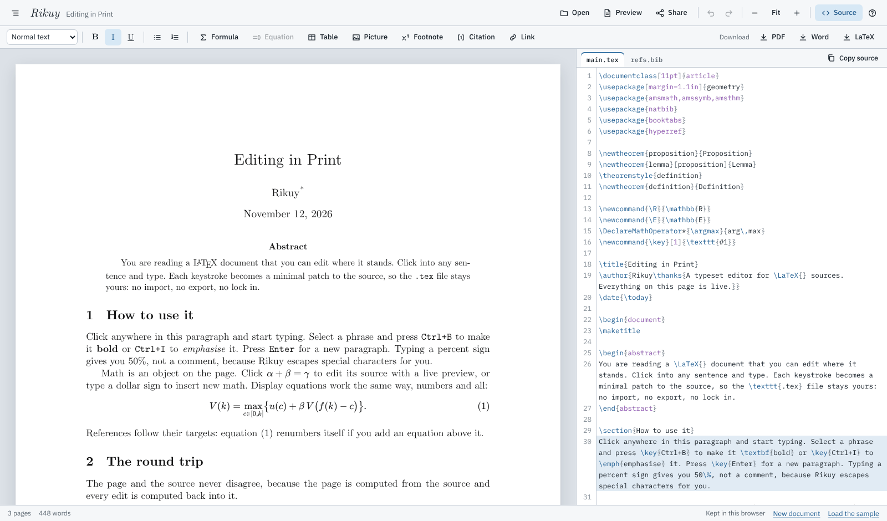

<div align="center">

<p><picture>
  <source media="(prefers-color-scheme: dark)" srcset="docs/logo-dark.png">
  
</picture></p>

**Word, PDF and LaTeX in one.**

[](https://rikuy.rackebrandt.pe/)
[](LICENSE)
[](https://github.com/pdfrackebrandt/rikuy/stargazers)

[Open Rikuy](https://rikuy.rackebrandt.pe/) ·
[How it works](docs/ARCHITECTURE.md) ·
[Report a bug](https://github.com/pdfrackebrandt/rikuy/issues/new/choose) ·
[Discussions](https://github.com/pdfrackebrandt/rikuy/discussions) ·
[For AI agents](https://rikuy.rackebrandt.pe/llms.txt)

</div>

Type on the typeset page as in Word, get the PDF from real TeX
Live, keep a clean `.tex` that Overleaf, Git and any TeX open. **Try it now at
<https://rikuy.rackebrandt.pe/>**: no install, no account. If it helps you, a star here is how
other people find it.

*Rikuy* is Quechua for "to see". It is a LaTeX editor in the browser where you type on the
typeset page. Click into a paragraph, a formula, a table cell or a footnote on the rendered page
and edit it there: Rikuy patches the `.tex` source in the smallest way that makes the change,
and undo gives the source back byte for byte. Real TeX Live 2026 (pdfTeX, XeTeX and LuaHBTeX,
compiled to WebAssembly) runs in a Web Worker and makes the PDF. Nothing is installed and there
is no account; documents stay in the browser until you send them, as a share link that carries
the document itself, a file, or a git push.



Open it at <https://rikuy.rackebrandt.pe/> (also reached as <https://rackebrandt.pe/rikuy/>): the
page installs as an app, works offline after one visit and reads and writes Word files. To build
the editor on your own machine you need node 22 and Python 3: `npm ci && npm run build && npm run serve`, then open http://127.0.0.1:8790. The PDF
pane also needs the TeX tree, which takes the longer build under [Running it](#running-it).

## What works

- **Typing on the page.** Text, bold and italic, formulas (in a MathLive field, written back
  as LaTeX), table cells, footnotes, `siunitx` quantities. The source pane shows every
  change as it lands.
- **Word's ribbon over the page.** Tabs as in Word (File, Home, Insert, Design, Layout,
  References, Review, View, Help, and Table Design and Table Layout or Header & Footer while
  their object is open), Word's keys for headings, Normal and bullets,
  a search box for any command by its name (Alt+Q), a right click menu of what applies where you
  are. Every button is a command of one registry, which agents find by name
  (`controls.json`, llms.txt) and run (`rikuy.api.run`).
- **Find, Replace, Go To and the outline, as in Word.** Ctrl+F searches the text the page shows
  (50% finds `\%`), every hit marked and listed with its context in the Navigation pane; Ctrl+H
  replaces through the same escaping as typing, Replace All as one undo, with Word's wildcards,
  regular expressions, a format, or in the LaTeX source itself; Ctrl+G goes to a page, heading,
  footnote, equation, figure, table, comment or label. The Navigation pane has the headings
  (drag one to move its section), thumbnails of the pages and the results; Alt+Shift and the
  arrows promote, demote and move headings with their sections, and paragraphs.
- **Tables as in Word.** Insert › Table's grid of sizes and Insert Table…, Convert Text to Table,
  a table from a .csv; Table Design and Table Layout while the caret is in a table: rows and
  columns in and out, merge and split, AutoFit, the nine alignments, looks, borders, shading,
  sorting, header rows that repeat on every page. New tables are booktabs; a table written with
  `\hline` is edited with `\hline`.
- **The page as in Word's Layout tab.** Margins, size, orientation, columns, breaks (Ctrl+Enter),
  line numbers, hyphenation, a watermark, the page's colour and border, headers and footers typed
  on the page with their page numbers: written as geometry, multicol, fancyhdr, lineno, edited
  where a hand written line has them, drawn on the page as TeX prints them, and carried to Word
  and back.
- **Lists as in Word.** Tab and Shift+Tab change an item's level; Word's bullet, numbering and
  multilevel libraries, Define New Bullet and Number Format, Set Numbering Value, Restart at 1,
  Continue Numbering, the space between items, Sort, description lists, and "- " or "1. " typed at a
  paragraph's start making a list; written as enumitem's options, a list's own hand written labels
  changed where they are.
- **The whole TeX Live 2026 toolchain.** The three engines, latexmk's reruns, bibtex and biber,
  makeindex and xindy, glossaries, and shell escape: Ghostscript, gnuplot, Python with Pygments
  (minted), dvips, Asymptote with 3D rendering, and TeX starting TeX (TikZ externalize,
  `standalone`).
- **Coauthors without accounts.** Share copies a link that opens the document ready to type in;
  the document travels inside the link, nothing is uploaded. (In the copy hosted on claude.ai the
  page cannot read the link it opens with, so the recipient pastes it onto the page once.)
  Coauthors who never write LaTeX type and comment on the page and send a link back; their edits
  arrive as tracked changes, merged with what you wrote meanwhile. Comments are LaTeX comment
  lines, so Overleaf, Git and TeX keep them and print nothing.
- **Overleaf and Git.** An Overleaf project comes in as its source .zip, or through Overleaf's
  Git integration; it leaves with one click to Overleaf, or as a plain .tex (.zip for several
  files). Git: clone, commit, push and pull. Access tokens are kept in the browser per host and
  sent only to that host (the one token earlier versions kept moves to the first host that
  accepts it); a remote that came in the .git folder of a project you opened gets no token until
  you give it one. A browser reaches a git server only through a CORS proxy, which
  sees your access token: the field starts with isomorphic-git's public proxy, and you can put
  your own there.
- **Projects.** Folders of files, zip import and export, the PDF beside the page with SyncTeX
  both ways.
- **Word, both ways.** Open a .docx (Open, drop or paste) and it becomes a LaTeX project: Word
  equations as LaTeX math, pictures in `figures/`, headings, lists, tables, footnotes, links, and
  Zotero or Mendeley citations as a `.bib`. Save as Word writes the page as a .docx with native,
  editable Word equations, footnotes, tables, figures, numbered cross references and citations
  set from your `.bib`. A coauthor edits that file in Word or LibreOffice, with or without
  Track Changes, and sends it back; opening it writes their edits into the `.tex` as the smallest
  patches, each one to accept or reject, their comments as comments, and anything that cannot be
  placed (text you changed meanwhile, generated numbers, a new table row) as a comment where it
  was. pandoc, compiled to WebAssembly, does the conversions in the browser; it loads (16 MB, once)
  only when a Word action is used. Not in the copy on claude.ai, which has no room for it.
- **Chinese, Japanese, Korean, Arabic, Hebrew, India's scripts, Thai and Sinhala.** Documents in
  them compile: Fandol fonts with ctex or
  xeCJK (XeLaTeX), Amiri with babel's `bidi=basic` (LuaLaTeX), the CJK package with Arphic fonts
  (pdfLaTeX), and Noto fonts with HarfBuzz for Devanagari (Hindi, Marathi), Bengali, Tamil,
  Telugu, Gujarati, Kannada, Malayalam, Gurmukhi and Odia, and likewise Japanese (Harano Aji),
  Korean (Nanum), Hebrew (Hadasim), Thai and Sinhala (LuaLaTeX). Type such text into a
  plain document and Rikuy offers the set up lines at one
  click. A right to left document reads right to left on the page, and Word files in both
  these scripts open and save. On the hosted build; the copy on claude.ai has no room for the fonts.
- **Live figures.** `\rikuywidget{plot.html}{plot.png}` from `rikuy.sty` (in `sample/widget/`,
  copied beside the document) runs a self contained HTML widget, sliders and all, on the typeset
  page, sandboxed; every TeX, Overleaf's included, prints the PNG. Widgets in a document from
  someone else run after one click.

## How close to a desktop TeX Live

Measured against Ubuntu 26.10's TeX Live 2026 on the 716 documents of the
[LaTeX-examples](https://github.com/MartinThoma/LaTeX-examples) corpus, comparing pages, text
and pixels at 72 dpi: **703 of the 705 documents both compile give equal PDFs** (99.7 %); the
other two differ on the desktop's side (a font it lists but cannot load, Debian's own build of a
font). Of TeX Live's 220 Asymptote examples, 211 give the desktop's asy's PDF or fail the same
way, 7 draw random data on purpose, and 2 differ (one in floating point, one out of memory).
Of 792 scripted edits on the typeset pages of the corpus, 781 land where they were made and 11
open their formula as source by design; all 792 undo exactly. The method, every number and every
mismatch with its cause: [PLAN.md](PLAN.md).

## Running it

Rikuy is one HTML page plus `dist/tex/` (about 327 MB of engines, TeX packs and programs, 78 MB of it the fonts for scripts other than Latin), which
any static web server can serve (`dist/index.html` is the page); the page fetches packs as a
document needs them. Served that way it is an app the browser can install: after one visit it
opens and works with no network, compiles what this browser has compiled before, and "Make
available offline" in the status bar keeps what a typical paper and the open document need (about 62 MB with the
engine); [docs/HOSTING.md](docs/HOSTING.md) puts it on Cloudflare Pages. Installed from Chrome or Edge on a computer, it opens `.tex`, `.bib` and Overleaf `.zip`
files from the file manager as Word opens `.docx`; on Android, files can be shared to it. The copy on claude.ai loads KaTeX, CodeMirror, MathLive and JSZip from jsDelivr and
needs the network; its fonts, the interface's IBM Plex included, are inside the page.

```sh
npm ci
tex/fetch_inputs.sh                      # build inputs into $RIKUY_WORK (default /tmp/eng), about 3 GB, every file checked by hash
python3 tex/build_tree.py tree && python3 tex/build_tree.py packs
npm run build                            # the page, into dist/
npm run serve:app                        # http://127.0.0.1:8791, the installed app as Cloudflare Pages serves it
npm run serve                            # http://127.0.0.1:8790, the page as the claude.ai artifact host serves it
```

The TeX build has been run on Ubuntu. It needs curl, sha256sum, sha512sum, dpkg-deb, Python 3
with `lz4` and, to run at a usable speed, a C compiler; [AGENTS.md](AGENTS.md) lists the setup
for everything else. The inputs unpack to about 10 GB, so point `RIKUY_WORK` at a disk with room:
`/tmp` is emptied on reboot and is memory on some systems.

To work on the editor alone, `npm ci && npm run build && npm run serve` is enough: the page runs
and its browser tests pass without the TeX tree; only the PDF pane needs it. `npm test` runs the
unit tests; [docs/ARCHITECTURE.md](docs/ARCHITECTURE.md) explains how the editor, the worker and
the TeX tree fit together; [tex/README.md](tex/README.md) covers the worker and the programs.

Rikuy's tests run in Chromium, and that is where it is known to work. The bundle is built for
Chrome 100, Firefox 100 and Safari 15 and later, but nothing tests Firefox or Safari yet; reports
from them are welcome.

## For AI agents

An agent that wants to hand someone a document, or to drive the editor, reads
[llms.txt](https://rikuy.rackebrandt.pe/llms.txt): a link with the LaTeX in it
(`#tex=<base64url>`), the scripting surface `window.rikuy.api` (read and replace the source,
compile, get the PDF and TeX's problems), and every control's name for an agent that clicks.
`npm run test:agent` checks all of it.

## Help Rikuy grow

- **Star the repository** (the button at the top right): it is how people searching GitHub
  find Rikuy, and it tells me what to keep working on.
- **Share it** with a coauthor, a lab or a course: send <https://rikuy.rackebrandt.pe/>, or a
  share link from inside Rikuy with your document in it.
- **Report what breaks.** [Open an issue](https://github.com/pdfrackebrandt/rikuy/issues/new/choose)
  with the document (or the smallest part of it that shows the problem), what you did and what you
  expected. A document that compiles on a desktop TeX Live and not here is the most useful report
  there is.
- **Ask for what is missing** with the idea form on the same page.

## Contributing

Issues and pull requests are welcome; [CONTRIBUTING.md](CONTRIBUTING.md) says how to check a
change. Coding agents: start with [AGENTS.md](AGENTS.md). Security problems go by email or
private report, not in an issue: [SECURITY.md](SECURITY.md).

## License

Rikuy is free software under the GNU Affero General Public License 3.0 or later
([LICENSE](LICENSE)). It ships TeX Live, BusyTeX, Ghostscript, Asymptote, Mesa and other free
software, each under its own license: [NOTICE](NOTICE) lists them, [SOURCES.md](SOURCES.md)
says where the exact source of each is, [LICENSES/](LICENSES) holds the license texts that
are not elsewhere in the repository, and [LICENSES/third-party/](LICENSES/third-party) the notices
of the libraries compiled into each program. `npm run build` puts all of them in
`dist/LICENSES.txt`.
